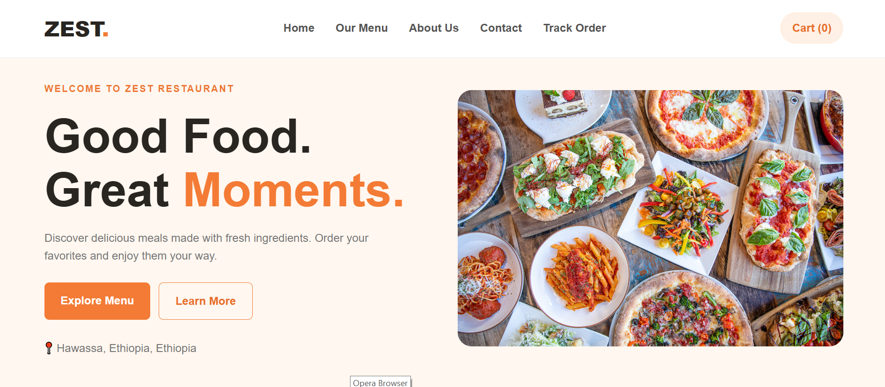
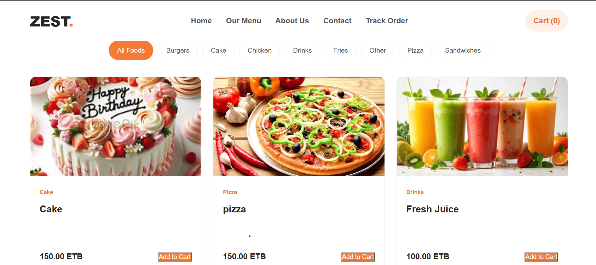
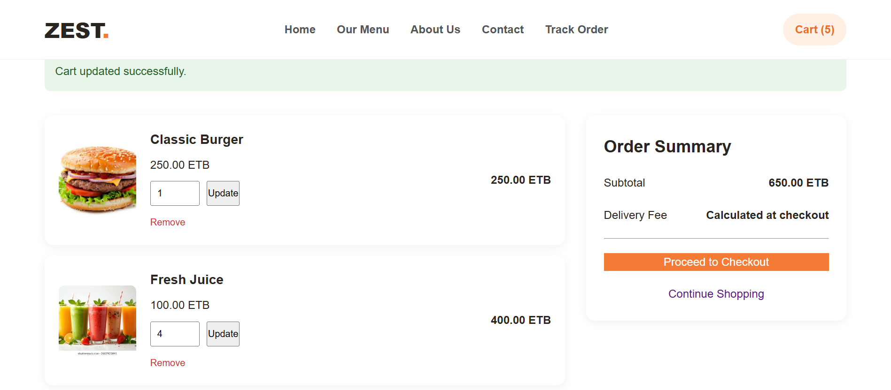
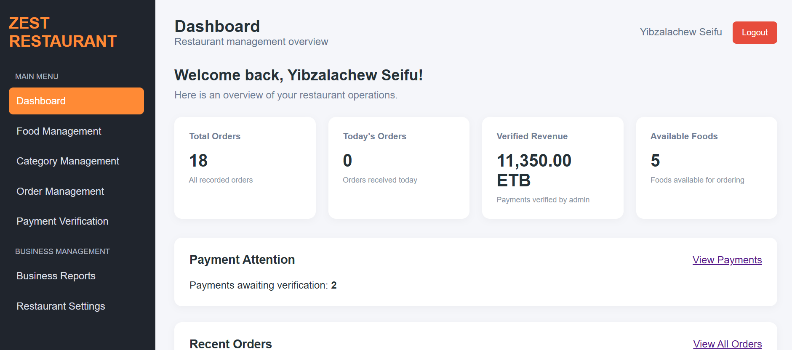
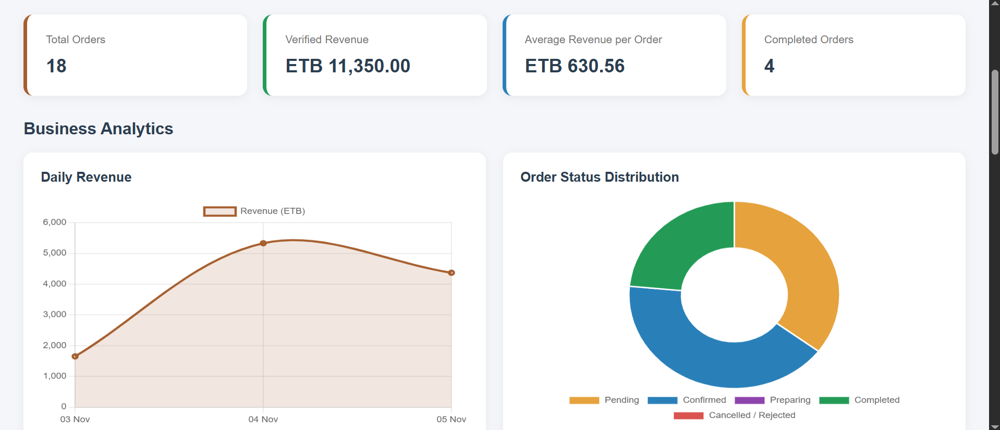

# Zest Restaurant Ordering System

A web-based restaurant ordering and management system built with PHP, MySQL, HTML, CSS, and JavaScript.

Zest allows customers to browse food items, add items to their shopping cart, place orders, submit payment information, and track their orders. Restaurant administrators can manage food items, categories, orders, payments, restaurant settings, and reports through an administration dashboard.

---

## Features

### Customer Features

- Browse available food items.
- View food details and prices.
- Browse food by category.
- Search and filter food items.
- Add food items to the shopping cart.
- Update item quantities.
- Remove items from the cart.
- Calculate order totals.
- Choose pickup or delivery.
- Submit customer and delivery information.
- Submit payment references.
- Track orders using an order number and phone number.
- Responsive interface for desktop, tablet, and mobile devices.

### Administrator Features

- Secure administrator login.
- Administrator dashboard.
- Manage food categories.
- Add, edit, and delete food items.
- Upload food images.
- Manage restaurant orders.
- View customer information.
- Verify submitted payments.
- Update order statuses.
- Manage payment methods.
- Configure restaurant settings.
- View reports and summaries.
- Export reports to Excel.
- Print or save reports as PDF.

### Payment Features

The system supports manual payment verification through:

- Telebirr
- Commercial Bank of Ethiopia (CBE)

Customers submit payment references, and administrators verify submitted payment information.

The application does not request customers' banking PINs or OTP codes.

### Reporting Features

- Order reports.
- Sales summaries.
- Payment reports.
- Food and category information.
- Date-based report filtering.
- Excel report export.
- Print-friendly reports for PDF saving.

---

## Screenshots

The following screenshots show the main customer and administrator features of Zest.

### 1. Homepage

The main page where customers can explore the restaurant and available food.



### 2. Food Menu

Customers can browse food items and explore available categories.



### 3. Shopping Cart

Customers can review selected food items, update quantities, and check their subtotal.



### 4. Admin Dashboard

Administrators can manage restaurant operations, orders, food items, and payments.



### 5. Reports

The reporting section provides restaurant business information and report exports.



---

## Technologies Used

| Technology | Purpose |
|---|---|
| HTML5 | Website structure |
| CSS3 | Website styling and responsive design |
| JavaScript | Client-side functionality |
| PHP | Backend development |
| MySQL / MariaDB | Database management |
| PDO | Secure database access |
| Composer | PHP dependency management |
| PhpSpreadsheet | Excel report generation |
| Git | Version control |
| GitHub | Source code hosting |
| XAMPP | Local development environment |

---

## Project Structure

```text
restaurant-ordering-system/
│
├── admin/
│   ├── dashboard.php
│   ├── login.php
│   ├── create_admin.php
│   └── ...
│
├── assets/
│   ├── css/
│   │   ├── style.css
│   │   └── admin.css
│   ├── js/
│   └── images/
│
├── config/
│   ├── database.php
│   ├── database.local.php
│   └── .htaccess
│
├── database/
│   └── schema.sql
│
├── includes/
│   ├── auth.php
│   ├── admin_helpers.php
│   └── ...
│
├── screenshots/
│   ├── homepage.png
│   ├── food-menu.png
│   ├── shopping-cart.png
│   ├── admin-dashboard.png
│   └── reports.png
│
├── uploads/
│   └── foods/
│
├── vendor/
│
├── composer.json
├── composer.lock
├── .gitignore
├── .htaccess
└── README.md
```

The structure above is representative. Some additional project files and folders are omitted for readability.

---

## Requirements

Before installing the application, make sure you have:

- PHP 8.0 or later.
- MySQL or MariaDB.
- Apache web server.
- Composer.
- Git (optional).

For local development, XAMPP is recommended.

---

## Installation Guide

Follow these instructions to install the application on a local computer.

### 1. Clone the Repository

Open your terminal and run:

```bash
git clone https://github.com/yibzalachew/zest-restaurant-ordering-system.git
```

Move into the project directory:

```bash
cd zest-restaurant-ordering-system
```

Alternatively, download the repository as a ZIP file and extract it into your web server directory.

For XAMPP, the directory is usually:

```text
C:\xampp\htdocs\
```

The final project path should be:

```text
C:\xampp\htdocs\restaurant-ordering-system
```

### 2. Create the Database

1. Start Apache and MySQL from XAMPP Control Panel.
2. Open phpMyAdmin:

   `http://localhost/phpmyadmin`

3. Create a database named:

   `restaurant_ordering_system`

4. Select the new database.
5. Open the Import tab.
6. Select:

   `database/schema.sql`

7. Click Import.

The schema file creates the required database tables and relationships.

**Important:** The database schema contains the database structure only. It does not include existing customer records, orders, administrator accounts, or private payment information.

### 3. Configure the Database Connection

Create this local configuration file:

`config/database.local.php`

Add the following code:

```php
<?php

declare(strict_types=1);

return [
    'host' => 'localhost',
    'dbname' => 'restaurant_ordering_system',
    'username' => 'root',
    'password' => ''
];
```

Change the database username and password if your MySQL installation uses different credentials.

This local configuration file is excluded from Git to protect database credentials.

For production hosting, configure the database environment variables instead:

- `DB_HOST`
- `DB_NAME`
- `DB_USER`
- `DB_PASSWORD`

Do not use the XAMPP root database account for a public production website. Create a dedicated database user with only the permissions the application needs.

### 4. Install PHP Dependencies

Open the terminal inside the project directory and run:

```bash
composer install
```

Composer installs the required PHP libraries.

Make sure the `vendor` directory is available after installation.

### 5. Create the First Administrator

A fresh installation does not contain an administrator account.

You must create the first administrator before accessing the administration dashboard.

#### Generate a private setup key

Run this command from the project directory:

```bash
php -r "echo bin2hex(random_bytes(32)), PHP_EOL;"
```

PHP generates a random 64-character hexadecimal key.

#### Create the private setup configuration file

Create:

`config/admin-setup.local.php`

Add:

```php
<?php

declare(strict_types=1);

return 'YOUR_GENERATED_64_CHARACTER_KEY';
```

Replace the placeholder with the key generated in the previous step.

Never publish this key or commit the file to GitHub.

#### Open the administrator setup page

For a local XAMPP installation, visit:

`http://localhost/restaurant-ordering-system/admin/create_admin.php`

For production, use your actual website address.

Enter:

- Full name.
- Username.
- Strong password.
- Password confirmation.
- Private setup key.

Submit the form to create the first administrator.

#### Remove the private setup key

After the administrator is successfully created, immediately delete:

`config/admin-setup.local.php`

The setup page will no longer allow another administrator to be created through the first-administrator setup process once an administrator account exists.

The setup key file is excluded through `.gitignore`.

### 6. Access the Application

Open the customer website:

`http://localhost/restaurant-ordering-system/`

Open the administrator login page:

`http://localhost/restaurant-ordering-system/admin/login.php`

Log in using the administrator credentials created during the first-administrator setup.

---

## Security Features

The application includes several security measures:

- Password hashing using PHP `password_hash()`.
- Password verification using `password_verify()`.
- PDO prepared statements.
- CSRF protection for sensitive requests.
- Session security settings.
- Administrator authentication and authorization.
- Login attempt rate limiting.
- Input validation.
- Output escaping to help prevent XSS.
- Protection against duplicate payment submissions.
- Restricted access to configuration and private files.
- Upload restrictions for food images.
- Private local configuration files excluded from Git.
- First-administrator setup protected by a private setup key.

Security must also be configured correctly on the production hosting server.

---

## Testing

The application has been tested locally using XAMPP.

Testing includes:

- Customer food browsing.
- Food search and category filtering.
- Shopping cart operations.
- Pickup and delivery checkout.
- Payment reference submission.
- Payment verification.
- Order management.
- Order tracking.
- Administrator authentication.
- Dashboard functionality.
- Reports and report filtering.
- Excel export.
- Mobile responsiveness.
- Database operations.
- Basic security checks.

The first-administrator creation process has also been tested using a separate test database.

---

## Project Status

<details>
<summary>Current development status</summary>

The main customer ordering workflow and administrator management functionality have been implemented and tested locally.

The project is prepared for further improvements and production deployment.

</details>

---

## Future Improvements

Possible future improvements include:

- Online payment gateway integration.
- Customer accounts and order history.
- Email and SMS notifications.
- Advanced inventory management.
- Real-time order notifications.
- Improved analytics.
- Progressive Web App (PWA) support.
- Cloud deployment and production optimization.

---

## Author

**Yibzalachew Seifu Abite**

Computer Science Graduate

Hawassa, Ethiopia

GitHub:

https://github.com/yibzalachew

---

## Repository

Source code:

https://github.com/yibzalachew/zest-restaurant-ordering-system

---

## License

This project is available for educational and portfolio purposes.

Review the applicable licensing terms before redistributing or using the project commercially.
